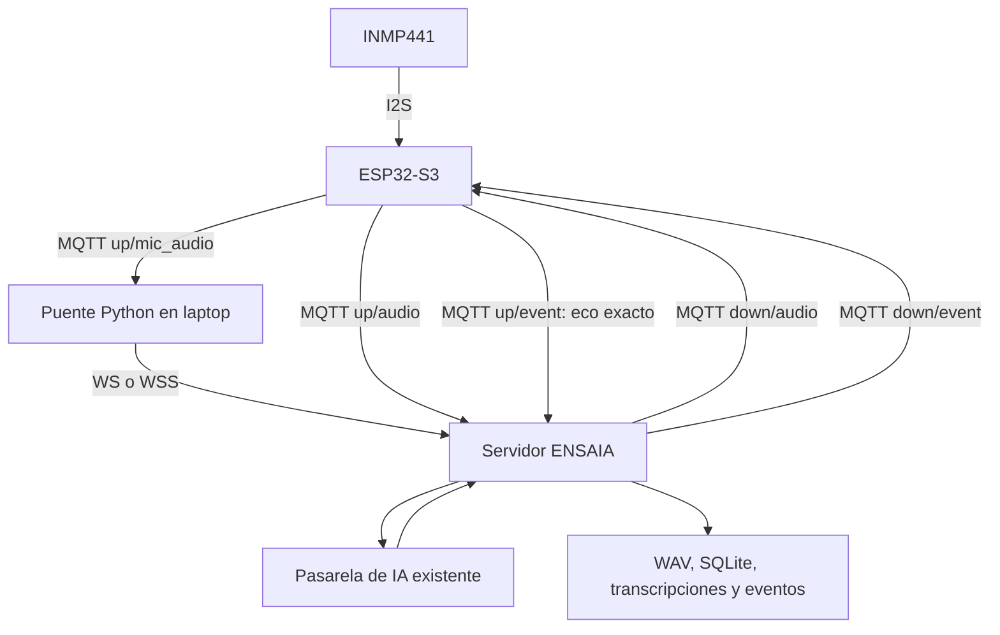

# Contexto de ENSAIA: incorporación del ESP32-S3 y micrófono INMP441

Actualizado: **26 de octubre de 2026**, zona horaria America/Lima.

## 1. Objetivo y estado actual

ENSAIA es un entrenador de expresión oral que registra voz, utiliza IA para transcribir y generar recomendaciones y conserva evidencias para comparar tomas Antes/Después.

En esta etapa se preparó la sustitución del micrófono del celular por un **INMP441 conectado a un ESP32-S3-DevKitC-1 N16R8**. El ESP32-S3 asume también el relevo MQTT que realizaba el ESP8266 anterior. La laptop conserva el servidor, el broker y la conexión con la IA.

El usuario confirmó que tiene la placa N16R8 y que realizó el cableado indicado. **Todavía no confirmó la carga del firmware, los resultados del Monitor Serie, una grabación física ni una sesión con IA usando este montaje.**

El código fue creado, compilado y probado por software. No se cargó a la placa desde este chat.

Workspace utilizado:

```text
/home/robertoa1/Datos/proyectos/iot-2
```

## 2. Antecedentes de implementación

La implementación anterior usaba el celular como micrófono y la placa RobotDyn UNO+WiFi R3 con ESP8266 como relevo MQTT. La captura llegaba al servidor y se enviaba a la placa; el audio devuelto por la placa era el que recibía la pasarela de IA.

El usuario proporcionó posteriormente una versión más reciente del proyecto en el archivo `/home/robertoa1/Datos/Descargas/entrenador_oratoria.rar`. La copia de fuentes y evidencias revisadas quedó en:

```text
/home/robertoa1/Datos/proyectos/iot-2/revision_ensaia_20261019
```

Esa versión incorpora EMQX y su acta declara 51 pruebas. Ese número pertenece a la versión anterior recibida; **no corresponde a las cinco pruebas nuevas del ESP32-S3 y no deben sumarse como si se hubieran ejecutado conjuntamente**.

La extracción de revisión excluyó secretos y otros archivos privados. Para ejecutar el sistema físico hay que utilizar la carpeta operativa del servidor con sus credenciales locales. La copia de revisión no debe suponerse lista para arrancar con credenciales reales.

La nueva integración se creó en una carpeta independiente. No se modificaron el código, las grabaciones ni las bases de datos anteriores para incorporarla.

## 3. Cableado acordado

Este cableado corresponde al **INMP441**. Si el micrófono físico es otro modelo I2S, debe verificarse su identificación y sus señales antes de aplicar estas conexiones.

| Micrófono INMP441 | ESP32-S3 | Uso |
|---|---|---|
| VDD / VCC | 3V3 | Alimentación de 3,3 V |
| GND | GND / G | Tierra común |
| SCK / BCLK | GPIO4, marcado 4 | Reloj de bits |
| WS / LRCLK | GPIO5, marcado 5 | Selección de ranura de audio |
| SD / DOUT | GPIO6, marcado 6 | Datos hacia el ESP32-S3 |
| L/R | GND / G | Seleccionar canal izquierdo |

Los números corresponden a **GPIO**, no al número de posición del conector. El micrófono no se alimenta desde 5V. Para programar y usar el Monitor Serie se indicó conectar el USB de datos al puerto UART/USB-to-UART de la placa.

Última aclaración solicitada por el usuario: **G y GND significan tierra**. El pin L/R selecciona canal: conectado a GND transmite por el izquierdo; conectado a 3V3 transmite por el derecho. El programa usa el canal izquierdo. GND y L/R del micrófono son dos pines distintos que se conectan a la misma tierra; pueden compartir una línea de protoboard.

## 4. Archivos creados y entregados

| Archivo | Función |
|---|---|
| [ENSAIA_ESP32S3.ino](/home/robertoa1/Datos/proyectos/iot-2/ensaia_esp32s3/firmware/ENSAIA_ESP32S3/ENSAIA_ESP32S3.ino) | Firmware de captura INMP441, conectividad y relevo MQTT |
| [config.h](/home/robertoa1/Datos/proyectos/iot-2/ensaia_esp32s3/firmware/ENSAIA_ESP32S3/config.h) | Plantilla de Wi-Fi, broker, identificador, pines y ganancia |
| [audio_format.h](/home/robertoa1/Datos/proyectos/iot-2/ensaia_esp32s3/firmware/ENSAIA_ESP32S3/audio_format.h) | Conversión de muestras y construcción del paquete binario |
| [puente_esp32.py](/home/robertoa1/Datos/proyectos/iot-2/ensaia_esp32s3/puente_esp32.py) | Integra la captura MQTT con la entrada del servidor existente |
| [LEEME.md](/home/robertoa1/Datos/proyectos/iot-2/ensaia_esp32s3/LEEME.md) | Guía de instalación, configuración, carga y grabación |
| [VERIFICACION.md](/home/robertoa1/Datos/proyectos/iot-2/ensaia_esp32s3/VERIFICACION.md) | Resultado de compilación, pruebas y límites de verificación |
| [test_esp32.py](/home/robertoa1/Datos/proyectos/iot-2/ensaia_esp32s3/tests/test_esp32.py) | Cinco pruebas locales sin hardware ni API real |
| [SHA256.json](/home/robertoa1/Datos/proyectos/iot-2/ensaia_esp32s3/SHA256.json) | Checksums del paquete de código entregado |
| [ENSAIA_ESP32S3_N16R8.zip](/home/robertoa1/Datos/proyectos/iot-2/output/ENSAIA_ESP32S3_N16R8.zip) | Distribución del firmware, puente, guía y pruebas |

Este `Context.md` se creó después de entregar el ZIP y su manifiesto. **No forma parte de ese ZIP ni de su manifiesto original.**

## 5. Arquitectura implementada



El puente es necesario porque la versión existente del servidor admite la entrada de micrófono por WS/WSS y no consume directamente los nuevos paquetes MQTT de captura. Se conservó su lógica de almacenamiento y relevo.

La clave del proveedor permanece en la laptop. El ESP32-S3 no ejecuta el modelo de lenguaje ni se conecta directamente al proveedor. La integración reutiliza la pasarela existente, configurada para `gpt-live-1`; no se modificó ni se validó con llamadas reales a la API durante este trabajo.

El micrófono del celular y el ESP8266 anterior ya no son necesarios en este montaje. El ESP8266 debe permanecer apagado si conserva el mismo identificador MQTT, para evitar conexiones con un client ID duplicado.

Para mantener compatibilidad hay tres trayectos de audio por el broker, aproximadamente 96 kB/s de PCM más cabeceras. No se prometió una latencia determinada ni se midió todavía en hardware.

## 6. Funcionamiento del firmware

- Captura I2S a **16 000 Hz**, con dos ranuras de **32 bits**; conserva la izquierda del INMP441.
- Convierte la salida de 24 bits alineada al MSB a **PCM16 con signo, mono, little-endian**.
- Forma bloques de **320 muestras**, equivalentes a 20 ms.
- Cada paquete ocupa **656 bytes**: SID ASCII de 8 bytes, secuencia uint32 LE, offset de muestras uint32 LE y 640 bytes PCM.
- La secuencia empieza en cero; el offset es `secuencia × 320`.
- Usa una tarea de captura y una cola de 100 bloques, aproximadamente dos segundos. La grabación completa se conserva en la laptop.
- Al arrancar muestra un medidor local `[MIC] Pico=.../32768`, pero no transmite el audio del micrófono hasta recibir una orden de inicio. El carácter `m` activa o desactiva el medidor por Serie.
- El medidor no representa decibelios calibrados. `MIC_GAIN` vale 1 inicialmente y puede ajustarse después de revisar nivel y saturación.
- Retransmite audio, confirma eventos mediante eco exacto y muestra transcripción y consejos por Monitor Serie a 115200 baudios.
- Publica estado aproximadamente cada dos segundos, con memoria, señal Wi-Fi, contadores y firmware `ensaia-s3-i2s-v1`.
- Los fallos de conexión, saturación de cola o desbordamiento I2S interrumpen la captura. No se renumeran tramas para ocultar pérdidas ni se reanuda automáticamente la misma toma.

No se implementó reproducción de voz en un parlante ni se agregó una pantalla.

## 7. MQTT y credenciales

Prefijo: `oratoria/v1/DEVICE_ID`.

Se mantienen los canales existentes `down/control`, `up/control`, `down/audio`, `up/audio`, `down/event`, `up/event` y `up/status`. Se agregaron:

| Canal nuevo | Dirección |
|---|---|
| `up/mic_audio` | ESP32-S3 → puente en laptop |
| `down/mic_control` | Puente → ESP32-S3 |
| `up/mic_control` | ESP32-S3 → puente, confirmaciones y errores |

Se utiliza QoS 0 para el audio y las publicaciones del firmware; las órdenes de captura tienen confirmación y reintento de aplicación. El estado es retenido y dispone de Last Will offline.

En la configuración de ejemplo se conservó `DEVICE_ID = "esp8266-oratoria"` para reutilizar los topics y las ACL anteriores. Ese texto no identifica automáticamente el procesador. Si se cambia, hay que coordinar servidor, firmware y autorizaciones del broker.

La plantilla `config.h` aún contiene datos de ejemplo. El usuario debe completar SSID, contraseña Wi-Fi, IP LAN de la laptop y credenciales MQTT del servidor operativo. No se incorporaron claves reales al código ni al ZIP.

EMQX usa normalmente **1884** como puerto exterior del laboratorio anterior. El broker integrado usa normalmente **1883**. **18083 es el dashboard de EMQX**. El firmware necesita la IP LAN de la laptop, no `localhost`. El puente, al ejecutarse en la laptop, sí puede utilizar localhost para acceder al servidor o broker.

## 8. Configuración de Arduino IDE comprobada

| Parámetro | Valor |
|---|---|
| Paquete de placas | esp32 by Espressif Systems 3.3.5 |
| Placa | ESP32S3 Dev Module |
| CPU | 240 MHz |
| Flash | 16 MB |
| Flash Mode | QIO 80MHz |
| PSRAM | OPI PSRAM |
| Particiones | 16M Flash (3MB APP/9.9MB FATFS) |
| USB CDC On Boot | Disabled usando UART |
| Velocidad de carga y Monitor Serie | 115200 |
| Bibliotecas externas | PubSubClient 2.8 y ArduinoJson 6.21.5 |

El controlador I2S forma parte del paquete ESP32. La carpeta del sketch debe conservar los tres archivos: `.ino`, `config.h` y `audio_format.h`.

FQBN usado en la compilación:

```text
esp32:esp32:esp32s3:FlashSize=16M,PSRAM=opi,FlashMode=qio,PartitionScheme=app3M_fat9M_16MB,CDCOnBoot=default
```

## 9. Uso del puente y registro de sesiones

Se inicia el servidor existente con su configuración operativa. La guía usa `run.py --localhost --env-file .env.emqx` para disponer de `http://127.0.0.1:8765` en la laptop. Si ya hay un servidor activo, debe usarse su URL y no arrancar otro sobre la misma base de datos.

El puente recibe `--proyecto` con la carpeta del servidor y `--env` con el mismo archivo de configuración que usa ese servidor. Reutiliza sus bibliotecas, usuario MQTT, contraseña, identificador y token de aplicación.

Opciones principales:

- `--participante`: código seudónimo de la toma.
- `--fase pre`, `post` o `practice`.
- `--segundos`: duración de la captura; el valor inicial es 60.
- `--sin-consejos`: desactiva feedback visible de esa toma.
- `--demo-ia`: micrófono real con proveedor de IA simulado, sin consumir API. Su transcripción de ejemplo no corresponde a lo hablado.
- `--consentimiento`: confirma la aceptación de grabación/procesamiento, requerida para iniciar la sesión.
- `--url`: URL del servidor; HTTP se admite solo en localhost.
- `--ca`: CA local si se usa HTTPS; no se omite la validación del certificado.
- `--registros`: destino opcional de los informes adicionales de captura.

Se espera el mensaje **GRABANDO** para hablar. El cierre automático detiene la fuente, verifica el total de tramas y solicita el guardado al servidor. Un primer Ctrl+C durante la grabación intenta cerrar y guardar normalmente.

No se debe iniciar simultáneamente otro micrófono desde la página del celular. La página existente sirve para revisar y exportar las sesiones.

El servidor conserva sus archivos habituales. Por compatibilidad, el WAV del relevo continúa llamándose `audio_via_esp8266.wav`, aunque esta nueva toma haya pasado por el ESP32-S3.

El puente añade `ID_esp32.json` en la carpeta de registros de este paquete. Ese archivo debe acompañar las evidencias del servidor; no se inserta automáticamente en el ZIP de exportación de ENSAIA.

Para declarar completo el transporte de una nueva toma, revisar conjuntamente:

1. Informe ESP32: `source_capture_complete=true` y tramas esperadas, recibidas y enviadas iguales.
2. Servidor: `audio_relay_complete=true`, `provider_audio_complete=true` y `pending_device_events=0`.
3. Para IA real y hardware físico: `demo=false` y `device_simulated=false`.

La integridad del transporte no demuestra que la transcripción sea literal o que haya mejorado la oratoria.

## 10. Verificación realizada

Se compiló realmente el sketch con el compilador y SDK oficiales de Arduino-ESP32 3.3.5 en un entorno temporal. No se modificó la instalación del Arduino IDE del usuario. Se omitieron dependencias de otras arquitecturas en el índice temporal de instalación, conservando el core, SDK, compilador y bibliotecas oficiales necesarios para S3.

Resultado del compilador:

```text
Programa: 899863 bytes, 28% de la partición de 3145728 bytes.
Variables globales: 51004 bytes, 15% de los 327680 bytes indicados.
```

La cifra de variables globales no incluye las reservas dinámicas de Wi-Fi, tareas y colas.

Se ejecutaron cinco pruebas:

1. Conversión C++ real de muestras y serialización binaria: signo, saturación, cabecera y orden de bytes.
2. Captura simulada por MQTT → puente → servidor → relevo MQTT → persistencia; comparación exacta de los WAV y confirmación de eventos.
3. Pérdida de una trama intermedia: detección del salto y sesión interrumpida.
4. Rechazo de paquetes truncados u offsets inválidos.
5. Detección de pérdida de la última trama mediante el total confirmado al detener la fuente.

Resultado: **5 passed, 1 warning in 8.56s**. La advertencia procede de `passlib/crypt` en el entorno Python 3.11. Las pruebas utilizan un proveedor de IA y nodo S3 simulados, con broker y servidor locales; no consumen API ni usan sesiones humanas como datos de prueba.

## 11. Pendientes y siguiente paso

El siguiente paso es completar `config.h`, cargar el sketch y comprobar el Monitor Serie. Debe informar 16 MB de flash, 8 MB de PSRAM, nivel de micrófono variable y conexión MQTT.

Después corresponde realizar una toma de práctica con `--demo-ia` y **escuchar el WAV** para comprobar voz, nivel y ausencia de saturación. Solo tras esa comprobación corresponde probar la pasarela real de IA y medir estabilidad, transcripción, consejos y latencia.

No se conoce todavía la IP real de la laptop, las credenciales del montaje, el resultado de la carga, la memoria detectada físicamente o la versión instalada en el Arduino IDE del usuario.

## 12. Contexto del artículo y de las tomas anteriores

En una etapa anterior del chat se trabajó la sección Materiales y métodos del artículo. La versión entregada quedó en [articulo_ENSAIA_materiales_metodos_actualizado.docx](/home/robertoa1/Datos/proyectos/iot-2/output/articulo_ENSAIA_materiales_metodos_actualizado.docx).

El usuario aclaró que **David realizó las diez evaluaciones identificadas D001–D010**: representan ejercicios de una sola persona, no diez participantes. Leyó guiones en ambas condiciones; primero con su ejecución habitual y, en la segunda lectura, después de revisar recomendaciones de una IA **antes de iniciar**. No se confirmó la plataforma exacta que generó esas recomendaciones previas.

Los guiones corresponden a cinco temas con dos variantes por tema: organización del tiempo, aprendizaje de errores, redes sociales, trabajo en equipo y pequeños hábitos. El diseño histórico debe describirse como lectura oral y comparación exploratoria de un participante. Las tomas repetidas no constituyen sujetos independientes ni demuestran por sí mismas causalidad o generalización poblacional.

El firmware actual permite consejos durante la lectura. Esa posibilidad **no cambia retrospectivamente la intervención histórica**, basada en consejos revisados previamente. Tampoco convierte las pruebas de software ni una demostración con IA simulada en resultados de mejora de oratoria.

## 13. Referencias técnicas consultadas

- [Espressif: ESP32-S3-DevKitC-1](https://docs.espressif.com/projects/esp-dev-kits/en/latest/esp32s3/esp32-s3-devkitc-1/user_guide_v1.1.html).
- [Espressif: I2S en ESP32-S3](https://docs.espressif.com/projects/esp-idf/en/stable/esp32s3/api-reference/peripherals/i2s.html).
- [Espressif: menú de herramientas de Arduino](https://docs.espressif.com/projects/arduino-esp32/en/latest/guides/tools_menu.html).
- [TDK: ficha técnica del INMP441](https://invensense.tdk.com/wp-content/uploads/2015/02/INMP441.pdf).
