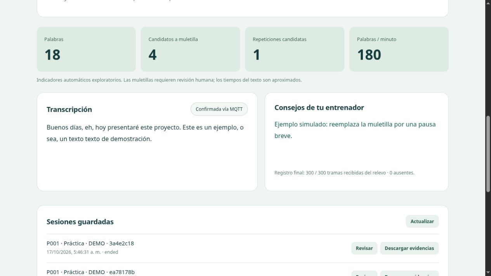
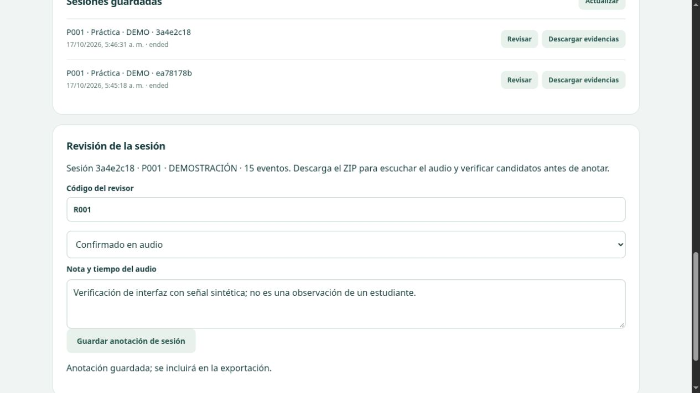

# Verificación de la entrega

Fecha: 17 de octubre de 2026. Las pruebas usaron señales sintéticas y participantes ficticios. **No constituyen resultados del estudio con estudiantes.**

## Resultado comprobado

**17 pruebas automatizadas aprobadas**, en 8.27 segundos. Salida conservada en [pruebas.txt](pruebas.txt).

- Tramas PCM16, validación de secuencia, fragmentación UTF-8 y conservación exacta del texto.
- Candidatos en palabras repartidas entre fragmentos, repeticiones, silencios y saturación exploratoria.
- Persistencia, confirmación MQTT sin duplicar eventos, recuperación de sesiones interrumpidas y conteo de pendientes mayor que el lote de reintento.
- Autenticación HTTP, rechazo de una segunda conexión de micrófono y conservación del propietario de la sesión.
- Recorrido de audio por **broker TCP y dos clientes MQTT reales**, con dispositivo y proveedor simulados.
- Cien tramas transmitidas equivalen a dos segundos de audio: se exportaron ambos WAV con 32 000 muestras a 16 kHz, texto, eventos y anotaciones.
- Pérdida controlada del relevo señalada como audio incompleto.
- Fallo de conexión del proveedor durante el cierre: evidencias conservadas y cierre no confirmado marcado explícitamente.
- Protocolo GPT-Live contrastado con un servidor WebSocket local que comprueba cabecera de autorización ficticia, `session.start`, modelo, PCM y cierre. **No se llamó a OpenAI.**
- Remuestreo en 16 000, 44 100 y 48 000 Hz mediante ejecución del AudioWorklet en un entorno de prueba con Node.js.

Dos avisos de dependencias: TestClient recomienda migrar su adaptador HTTP de pruebas, y passlib avisa de la retirada futura de `crypt`. No impidieron las pruebas. Se especifica Python 3.11/3.12 para esta entrega.

## Compilación del firmware final

Compilación correcta con Arduino CLI 1.5.1, ESP8266 Core 3.1.2, PubSubClient 2.8 y ArduinoJson 6.21.5.

Destino: `esp8266:esp8266:generic:xtal=160,eesz=8M6M,FlashMode=dout`.

| Recurso | Uso informado por el compilador |
|---|---|
| RAM de variables globales y estáticas | 33 644 / 80 192 bytes, 41 % |
| RAM de instrucciones, incluida caché | 59 747 / 65 536 bytes, 91 % |
| Código en flash | 256 904 / 1 048 576 bytes, 24 % |

La compilación no mide heap libre durante una sesión ni demuestra estabilidad de la placa. Se comprobó adicionalmente con ArduinoJson 6 una carga de consejo con UTF-8: deserialización de entrada constante sin alterar los bytes que se retransmiten, con 723/2048 bytes de documento en esa prueba de escritorio. No se proporciona un binario con credenciales; cada usuario compila con su `secrets.h`.

## Interfaz y HTTPS

Se verificó en navegador la conexión local, la demostración sintética, el guardado, la revisión, una anotación y la descarga del ZIP. La segunda demostración completó **300/300 tramas**, cero ausentes y cero eventos pendientes. La pantalla marca que es demostración y el consejo se identifica como simulado.

Se revisó una vista de 390 × 844: el contenido no excedió el ancho del viewport. Esto comprueba el diseño adaptable, no la captura con un teléfono físico.

El servidor HTTPS respondió `200 {"ready":true}` usando `https://127.0.0.1:18443/health`, verificando la CA generada y el nombre de host, **sin desactivar validación TLS**. La instalación de confianza en un celular queda a cargo del usuario. Los servidores temporales de verificación se cerraron al terminar.

## Validación pendiente con equipo real

- No se programó ni se conectó físicamente la placa del usuario.
- No se usó una clave API real ni se comprobó acceso de su cuenta a GPT-Live 1.
- No se midió latencia de feedback, precisión del reconocimiento o preservación de muletillas en español peruano.
- No se verificaron sesiones con celular físico ni el futuro capturador ESP32 + INMP441.
- La arquitectura implementada utiliza una pasarela en la laptop. La conexión directa ESP8266 → OpenAI no forma parte de esta entrega.

Los registros de demostración se excluyen del paquete distribuible. No se incluyen `.env`, certificados privados, credenciales Wi-Fi, base de datos ni sesiones del entorno de trabajo.
