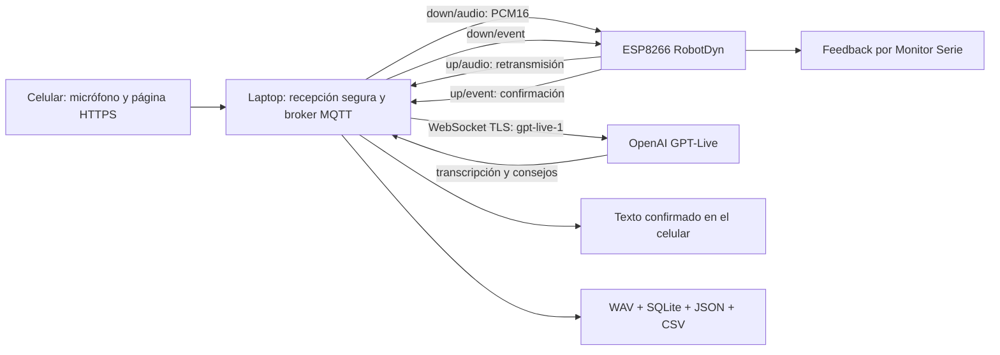

# Entrenador IoT de exposiciones con GPT-Live 1

Prototipo para grabar desde un celular, obtener transcripción y feedback de IA durante la exposición, retransmitir audio y registros mediante un ESP8266 y conservar evidencias en una laptop.

Laboratorio con broker EMQX externo, publicador, suscriptor y verificador: [guía y comandos](docs/LABORATORIO_EMQX.md).

**Lee primero [la viabilidad y las diferencias respecto a la arquitectura inicial](docs/VIABILIDAD.md).** El modelo solicitado se conserva: `gpt-live-1`. El firmware se ejecuta en el ESP8266 de la placa RobotDyn UNO+WiFi R3 de la imagen; el ATmega328P no participa en esta fase.

## Arquitectura implementada



La laptop **es también una pasarela para OpenAI**. El ESP8266 no mantiene la conexión TLS con GPT-Live y no guarda la clave API. Este es un cambio explícito respecto a la conexión directa que se planteó inicialmente. El micrófono del celular llega a la placa a través del broker de la laptop; el audio que se envía a GPT-Live es el que vuelve desde la placa. No se omite al ESP8266 en el modo real.

La carpeta anterior `simulacion_mqtt` corresponde al proyecto de confort térmico y permanece separada.

## 1. Preparar el servidor de la laptop

Requisitos: Python **3.11 o 3.12**, Wi-Fi de 2.4 GHz accesible por el ESP8266 y el celular, acceso a Internet para GPT-Live y una clave API con acceso al modelo. Una suscripción de chat no acredita por sí sola saldo de API.

Desde esta carpeta:

```bash
python3 -m venv .venv
.venv/bin/python -m pip install -r requirements-lock.txt
.venv/bin/python tools/configurar.py --ip 192.168.1.10
```

Sustituye `192.168.1.10` por la **IPv4 de la laptop en tu red Wi-Fi**. El configurador genera `.env`, certificados locales y `firmware/EntrenadorESP8266/secrets.h`. Se pueden regenerar los certificados para otra IP repitiendo el comando; las credenciales existentes se conservan. Si la IP cambia, vuelve a cargar el firmware con la dirección nueva.

En `.env`, completa:

```dotenv
OPENAI_API_KEY=tu_clave_api
LIVE_MODEL=gpt-live-1
MQTT_HOST=127.0.0.1
MQTT_PORT=1883
SIMULATE_DEVICE=false
```

Conserva `APP_TOKEN` y `MQTT_PASSWORD` generados. El primero permite entrar a la aplicación; el segundo autentica la placa en el broker. **No son la clave de OpenAI.** El modelo no se sustituye silenciosamente por otro. Se limita cada sesión a cinco minutos por defecto mediante `MAX_SESSION_SECONDS=300`.

## 2. Configurar Arduino IDE para tu placa

Abre `firmware/EntrenadorESP8266/EntrenadorESP8266.ino`.

En el gestor de bibliotecas instala estas versiones:

- **PubSubClient**, autor Nick O'Leary, **2.8**.
- **ArduinoJson**, autor Benoit Blanchon, **6.21.5**. Este sketch usa la API de la versión 6.

Se verificó la compilación con **ESP8266 Arduino Core 3.1.2**. Ya tienes instalado el entorno del ESP8266; no es necesario reinstalar Arduino IDE.

Selecciona:

| Opción | Valor |
|---|---|
| Placa | **Generic ESP8266 Module** |
| CPU Frequency | **160 MHz** |
| Flash Mode | **DOUT** |
| Flash Frequency | **40 MHz**, si aparece |
| Flash Size | **8MB (FS:6MB OTA:~1019KB)** para la variante indicada en tu imagen |
| Upload Speed | **115200** |
| Puerto | El puerto USB de la placa CH340 |
| Monitor Serie | **115200 baudios** |

Hay variantes comercializadas como **32 Mb = 4 MB**. La imagen que facilitaste indica **8 MB**. El sketch imprime `Flash detectada` al iniciar: si tu unidad real informa 4 MB, ajusta Flash Size a 4 MB y vuelve a cargar. Los 8 MB son flash, no RAM.

### Interruptores DIP de la RobotDyn

Con la alimentación desconectada, configura el bloque de ocho interruptores según sus números y la marca ON de la placa:

| Uso | 1 | 2 | 3 | 4 | 5 | 6 | 7 | 8 |
|---|---|---|---|---|---|---|---|---|
| **Cargar sketch al ESP8266** | OFF | OFF | OFF | OFF | ON | ON | ON | OFF |
| **Ejecutar y usar Monitor Serie del ESP8266** | OFF | OFF | OFF | OFF | ON | ON | OFF | OFF |

Pasos:

1. Pon los DIP en modo de carga y conecta la placa por USB.
2. En `secrets.h`, completa `WIFI_SSID`, `WIFI_PASSWORD` y verifica que `MQTT_HOST` sea la IPv4 de la laptop. La contraseña MQTT se genera desde `.env`.
3. Pulsa **Subir**. Si no entra al cargador, pulsa el botón **ESP Reboot** y reintenta. No selecciones Arduino Uno como destino de este sketch.
4. Desconecta, cambia al modo de ejecución, vuelve a conectar y abre el Monitor Serie a 115200.
5. Inicia el servidor de la laptop. Debes ver `MQTT conectado` y la IP de la placa.

En esta fase no se conectan sensores a los pines del ATmega328P ni se carga firmware en ese procesador. Los conectores D0-D13 del formato Uno no equivalen a los GPIO del ESP8266. El feedback de la placa aparece por **Monitor Serie**; la placa no incluye un altavoz para reproducir la voz de GPT.

## 3. Activar el micrófono del celular

Desde el celular, una página `http://IP_DE_LAPTOP` no tiene el contexto seguro necesario para `getUserMedia`. Se entrega HTTPS local con un certificado emitido por la CA del laboratorio.

1. Copia **solo `certs/root-ca.crt`** a tu celular de pruebas e instálalo como certificado de CA de confianza, siguiendo el procedimiento del sistema. En iOS, un perfil instalado puede requerir activar también la confianza para SSL.
2. Conserva `.key`, `.env` y `secrets.h` en la laptop. El configurador no instala certificados automáticamente.
3. Inicia el servidor:

```bash
.venv/bin/python run.py
```

4. Conecta el celular y la placa a la misma red que la laptop y abre **`https://IP_DE_LAPTOP:8443`**. El certificado debe estar reconocido y corresponder a la IP configurada.
5. Ingresa el valor `APP_TOKEN` de `.env` y pulsa **Conectar**.
6. Usa un código de participante, como `P001`, elige Antes/Después/Práctica y la condición con o sin consejos. Marca la aceptación de grabación.
7. Pulsa **Iniciar con GPT-Live** y concede el permiso del micrófono. Mantén la pantalla activa y el navegador en primer plano.
8. Pulsa **Finalizar y guardar**. El cierre espera el drenaje del audio, el cierre del proveedor y la confirmación MQTT de los registros.

La opción de escuchar respuestas en el celular está desactivada inicialmente. Si la activas, usa auriculares: reproducirlas por altavoz puede introducir la voz del entrenador en la grabación del estudiante. El texto y el Monitor Serie permiten dar feedback sin altavoz adicional.

Permite en el firewall de la laptop **8443/TCP** para el celular y **1883/TCP** para la placa, únicamente desde la red local del piloto. Evita una red de invitados con aislamiento entre clientes. El broker incluido requiere contraseña; este piloto usa MQTT TCP local sin cifrado. La conexión con OpenAI y la página del celular usan TLS. Para desplegar fuera de la red de pruebas se requiere endurecer MQTT y el acceso al servicio.

## 4. Demostración sin placa ni consumo de API

```bash
.venv/bin/python run.py --demo --localhost
```

Abre **`http://localhost:8765` en la laptop**, entra con `APP_TOKEN` y pulsa **Probar sin micrófono ni API**. Un nodo virtual, con su propia conexión MQTT, retransmite una señal sintética y frases de demostración. No solicita el micrófono ni interpreta voz real. Se identifica como **DEMO** en pantalla y en los archivos.

`--demo` cambia únicamente el nodo físico por uno virtual. El botón de demostración selecciona el proveedor simulado. Si configuras una clave y pulsas Iniciar con GPT-Live mientras usas un nodo virtual, se usaría la API real y los registros seguirían marcando el dispositivo como simulado.

Para probar el celular sin placa, usa `run.py --demo` con HTTPS y el certificado instalado; la sesión de demostración sigue siendo sintética.

## 5. Qué se guarda y cómo exportarlo

La revisión de candidatos por revisor, rúbrica de claridad/organización, encuesta de utilidad/distracción y comparación Antes/Después están descritas en [EVALUACION.md](docs/EVALUACION.md). Reinicia el servidor después de actualizar para crear las tablas adicionales sin modificar las grabaciones existentes. Las nuevas herramientas aparecen en **Revisar** y **Comparar Antes y Después**.

En **Sesiones guardadas**, pulsa **Descargar evidencias**. El ZIP de cada sesión incluye:

- `sesion.json`: participante seudónimo, etapa, condición, inicio y fin UTC, estado, duración y resumen.
- `microfono_original.wav`: audio recibido del celular, antes de retransmitirlo por el ESP8266.
- `audio_via_esp8266.wav`: audio que volvió de la placa y se envió a la IA; los huecos detectados se rellenan con silencio y se señalan en el resumen.
- `respuesta_gpt.wav`, si el proveedor emitió voz: audio del entrenador separado del estudiante.
- `transcripcion_estudiante.txt`: fragmentos del estudiante concatenados exactamente como los entregó el modelo.
- `eventos.json` y `eventos.csv`: transcripción, consejos, candidatos y eventos de sesión; incluyen la confirmación recibida desde el ESP8266.
- `provider_events.jsonl`: eventos originales del proveedor, excluyendo el audio codificado que se conserva como WAV.
- `indicadores.json` y `silencios.json`: indicadores y calidad de transporte.
- `revision_humana.json`: anotaciones realizadas en la interfaz o por API.

La base relacional se encuentra en `data/oratoria.sqlite`. `sessions`, `events` y `annotations` conservan su vínculo por sesión y evento. El outbox de texto es persistente: los registros no confirmados se reintentan cuando el nodo vuelve a estar disponible. Las sesiones abiertas tras reiniciar el servidor se marcan como interrumpidas.

Se distinguen **duración de audio**, **duración de la sesión** y **duración facturada por el proveedor**. La sesión incluye preparación de conexión y cierre; no debe usarse como denominador del ritmo de habla. Los tiempos absolutos provienen de la laptop; comprueba que su reloj esté sincronizado. La interfaz convierte UTC a la hora local del dispositivo.

## 6. Indicadores y límites de interpretación

- Candidatos a pausas rellenas como `eh`, `em` y `mmm` identificados en el texto recibido.
- Candidatos contextuales como `este`, `bueno`, `pues`, `digamos` y `o sea`; no toda aparición es una muletilla.
- Repeticiones de palabras consecutivas.
- Palabras por minuto de audio capturado.
- Intervalos con RMS bajo de al menos 800 ms; son una heurística, no una medición clínica de pausas.
- Proporción de muestras saturadas, tramas originales/retransmitidas, pérdida y duplicados.

**No es posible prometer detectar todas las muletillas con una transcripción automática.** El modelo puede omitir sonidos o normalizar el habla. Los candidatos quedan como `pending_human`; la revisión del audio es la referencia para el paper. Los tiempos de GPT-Live corresponden a fragmentos aproximados, no a marcas exactas por palabra. No se calculan decibelios calibrados ni diagnósticos emocionales.

Se preservan los fragmentos antes de analizarlos, incluyendo palabras incompletas entre deltas, espacios y repeticiones. La segmentación de un flujo no se presenta como nuevos participantes o muestras independientes.

Se incluye una [propuesta de piloto antes/después en una jornada](docs/PILOTO_ANTES_DESPUES.md), con población accesible, grupo de comparación, revisión humana y estimación de tiempo y consumo. Los resultados deben medirse; no se presupone una mejora por haber construido el sistema.

## 7. Cambiar después a ESP32 + INMP441

El INMP441 es un micrófono **I2S**, no un dispositivo UART ni una señal analógica que se conecte directamente a TX/RX. El ESP32 futuro puede capturar PCM16 mono a 16 kHz y reemplazar al navegador como fuente, utilizando la misma API y el protocolo de tramas descrito en [PROTOCOLO.md](docs/PROTOCOLO.md).

El flujo mantendría **INMP441 → ESP32 capturador → pasarela/broker → ESP8266 → pasarela GPT-Live**. El adaptador de captura del ESP32 y su cableado no se implementan en esta fase. No se promete conectar el INMP441 directamente al ESP8266 combinado ni que los pines de la imagen soporten ese montaje.

## 8. Verificación y diagnóstico

```bash
.venv/bin/python -m pytest -q
```

Las pruebas de integración abren puertos locales, utilizan MQTT TCP real, un nodo virtual y un proveedor simulado. No requieren clave ni generan consumo de API. La prueba del remuestreador necesita Node.js; es una dependencia de desarrollo, no del servidor.

| Síntoma | Revisión |
|---|---|
| Arduino intenta compilar para AVR | Seleccionar Generic ESP8266 Module y modo DIP de carga del ESP |
| Error de carga | DIP 5/6/7, cable de datos, puerto y botón ESP Reboot |
| Wi-Fi no conecta | SSID/clave y red de 2.4 GHz |
| MQTT no conecta | Servidor activo, IP de laptop, contraseña, firewall y aislamiento Wi-Fi |
| Botón GPT-Live deshabilitado | Revisar `.env`, reiniciar servidor y comprobar nodo conectado |
| No aparece permiso de micrófono | HTTPS confiable, certificado para la IP y permisos del navegador |
| GPT-Live devuelve error | Acceso al modelo, clave API, saldo y conectividad; no se cambia de modelo |
| Texto con demora | Revisar red, log del nodo y latencia del proveedor; no hay garantía de tiempo real duro |
| Reinicio del ESP durante una sesión | La sesión se interrumpe; iniciar otra para conservar trazabilidad |
| Exportación señala pérdida | Revisar audio original y no presentar el relevo como completo |

La compilación verificada y los resultados de pruebas se documentan en `evidencias/VERIFICACION.md`. La API real y la placa física requieren una validación posterior con tu clave y tu dispositivo.
